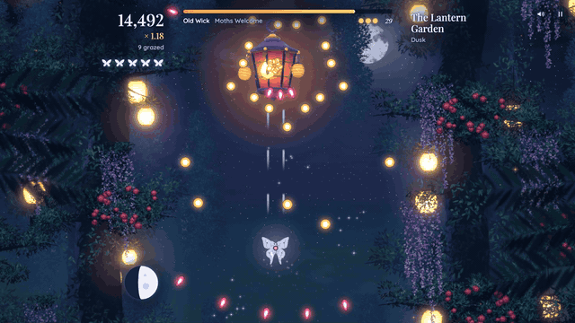
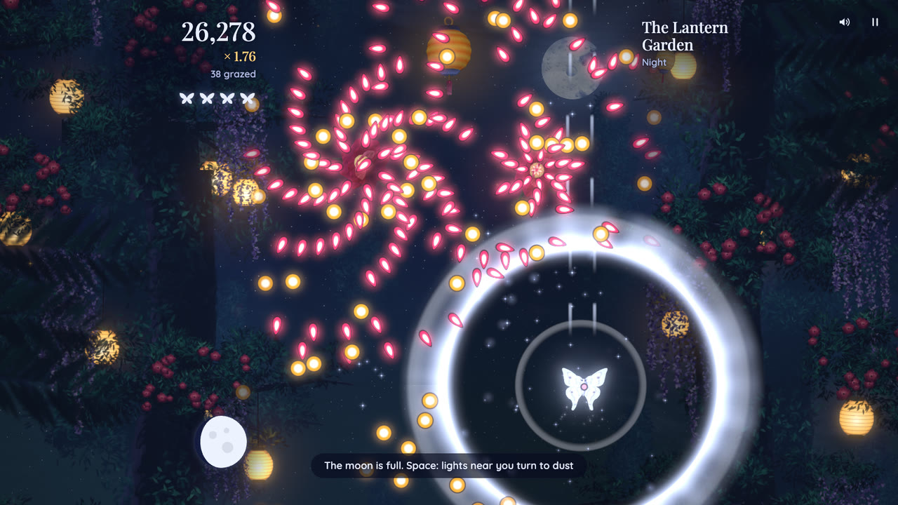
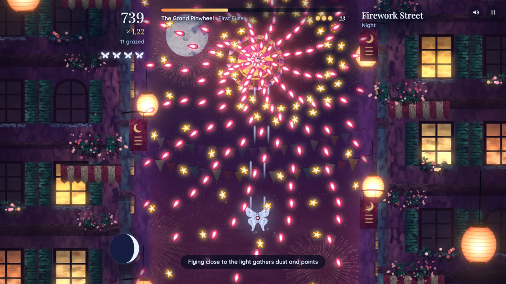
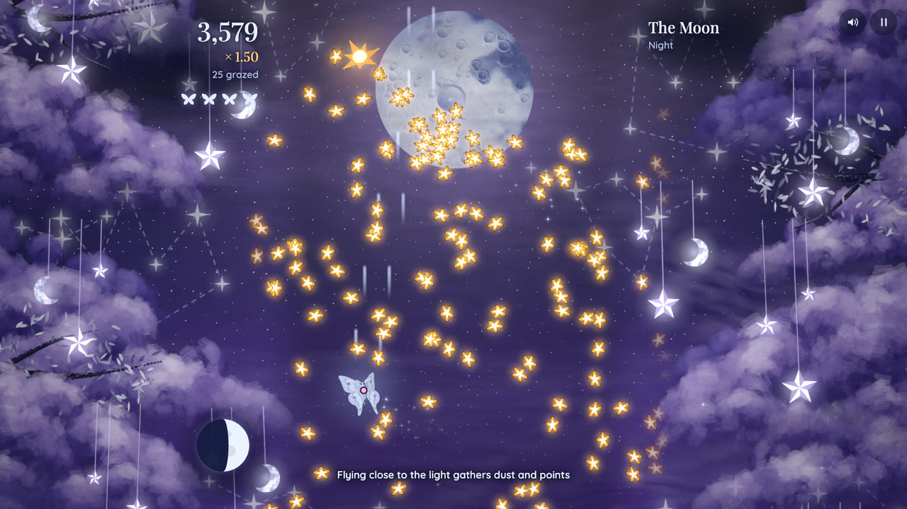

# Moth Hour

A bullet hell about a moth that flies from lamp to lamp towards the moon, in Babylon.js and TypeScript. Fly close to the light to fill the moon, then call an eclipse that turns every bullet near you to dust.

[](https://oryn.dev/games/moth-hour)

**[Play it in your browser](https://oryn.dev/games/moth-hour)**, no download needed. It also runs on phones.

## What is inside

- Five stages with a boss each: Lantern Garden, Firework Street, Lighthouse, Clock Tower and the Moon
- Grazing as the core rule: near misses gather dust, fill the moon and raise the multiplier
- The eclipse, which clears bullets around you, and six perks to pick between stages
- Three difficulties (Dusk, Night, Deep Night), an endless mode and a daily night that is the same for everyone
- A gentle first minute, so new players can learn the patterns
- The bullet simulation is separate from the rendering and runs at a fixed step

<p>
  
  
  
</p>

## Start it on your computer

You need [Node.js](https://nodejs.org) 20.19 or newer.

```bash
git clone https://github.com/oryn-dev/babylonjs-bullet-hell.git
cd babylonjs-bullet-hell
npm install
npm run dev
```

Then open the address it prints, usually http://localhost:5173.

`npm run build` writes the finished game to `dist/`. It is a plain static folder, so you can put it on any web host or upload it to itch.io as an HTML game.

## Controls

| | Keyboard and mouse | Gamepad | Touch |
| --- | --- | --- | --- |
| Fly | Arrow keys, W A S D or mouse | Left stick | Drag anywhere |
| Slow and precise | Shift | Y | Small finger moves |
| Eclipse (full moon) | Space | A | Moon button |
| Pause | Esc or P | Start | Pause button |

The moth shoots on its own.

## Change it

| File | What it does |
| --- | --- |
| `src/game/game.ts` | Where the game starts |
| `src/game/sim/stages/` | One file per stage: waves, bosses and their patterns |
| `src/game/sim/emitters.ts` | The bullet emitters that patterns are built from |
| `src/game/sim/difficulty.ts` | The three difficulties |
| `src/game/view/` | Everything you see: moth, lamps, scenery, batches |
| `src/game/ui/` | Menus, HUD and perk cards |
| `game/tuning.json` | 65 values such as bullet speed, density and lives |
| `game/look.json` | Sky, light, fog and post effects |
| `public/assets/` | Models, textures, sounds and fonts |
| `src/oryn/` | A small base around Babylon.js: start, light, input, sound, saves, settings |

`npm run typecheck` checks the types.

## Open it in Oryn

The project follows the layout of [Oryn](https://oryn.dev), so you can open it there and keep building by chat, with the game running next to it.

1. Sign in at [oryn.dev](https://oryn.dev) and start a new game.
2. Choose **From GitHub** in the menu next to the prompt.
3. Paste `https://github.com/oryn-dev/babylonjs-bullet-hell` as the public repository URL and press **Import project**.

You get your own copy. This repository stays as it is.

## Make it yours

A few things you could ask for after the import:

- "Add a sixth stage inside a thunderstorm with a weather vane as the boss"
- "Give me a perk that splits every tenth shot into five"
- "Change the moth into a paper plane and the lamps into paper lanterns"

When you like the result, publish it as a page anyone can play, or export it as a [mobile app](https://oryn.dev/mobile-game-maker) for Android and iOS or as a Windows, Mac, Linux or Steam build. Exports need a paid plan, and you publish with your own store accounts.

## More games with source

- [Furnace Choir](https://github.com/oryn-dev/babylonjs-boomer-shooter), a boomer shooter
- [Deep Salvage](https://github.com/oryn-dev/babylonjs-submarine-game), a submarine game
- [Channel 6: Night Shift](https://github.com/oryn-dev/babylonjs-horror-game), a horror game
- [Tornado Simulator: Storm County](https://github.com/oryn-dev/babylonjs-tornado-simulator), a tornado simulator

## License

The code and our own assets are [MIT](LICENSE): use them, change them, sell what you make. Third-party assets and libraries are listed in [ASSETS.md](ASSETS.md). The Oryn name and logo are not part of the license.
